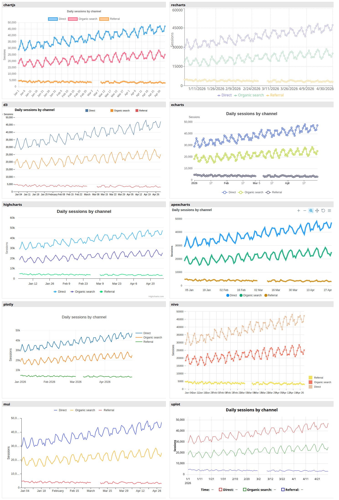
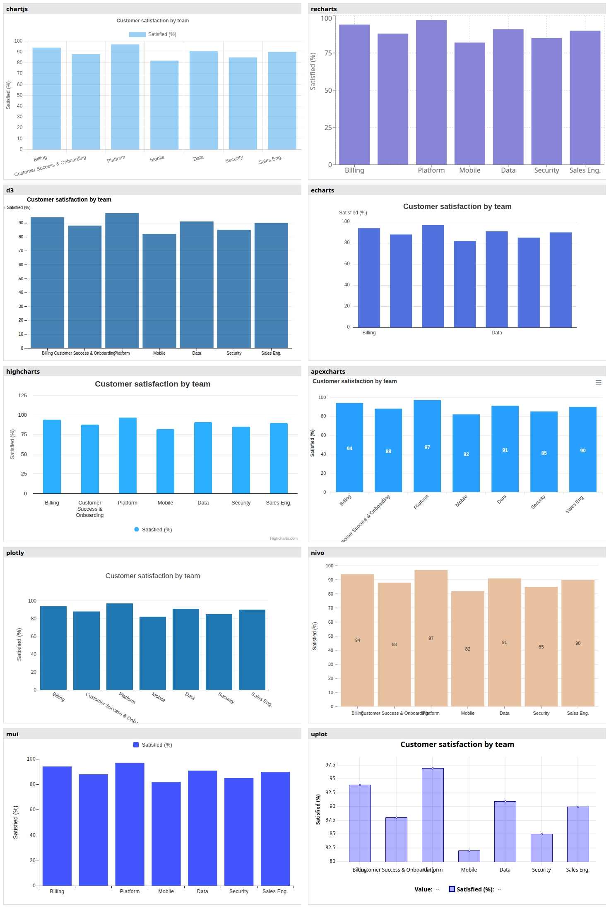
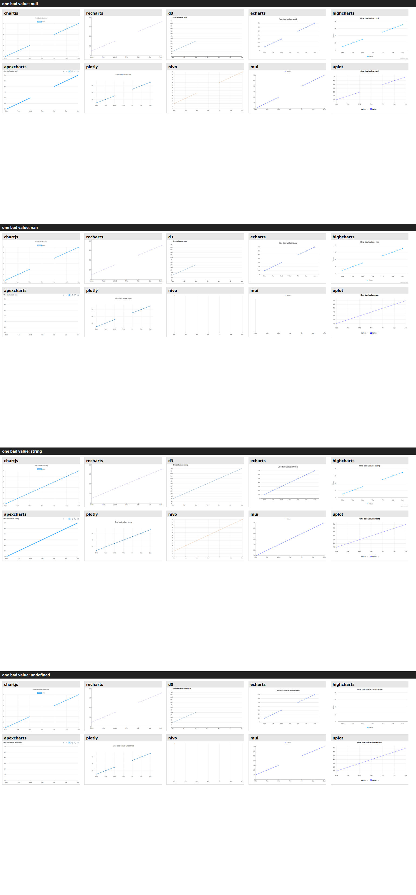
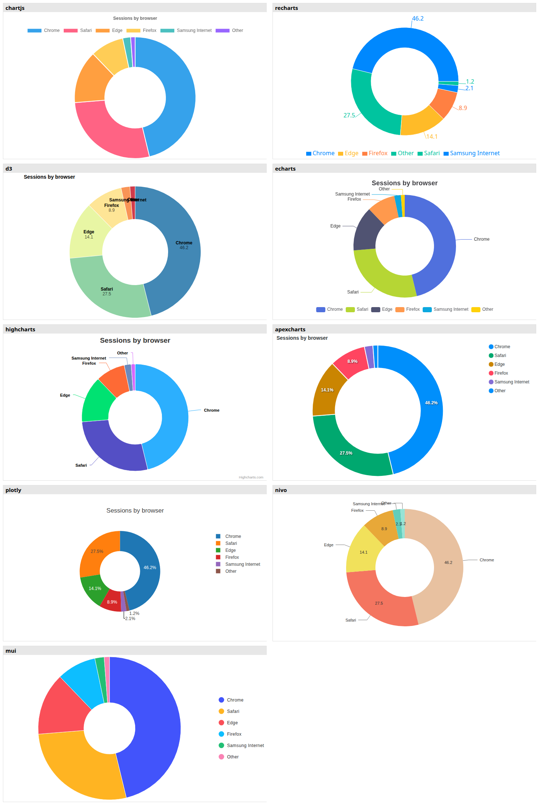
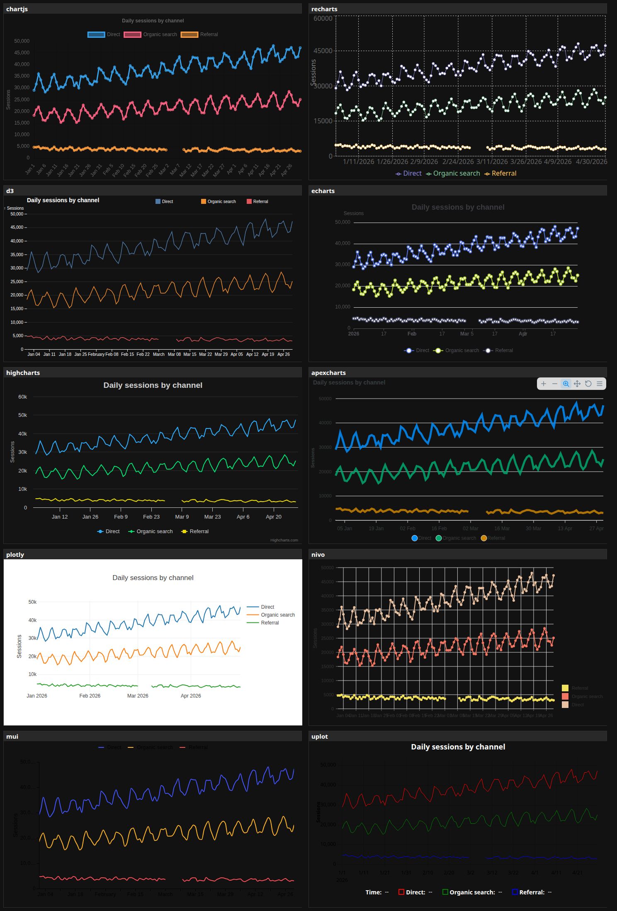
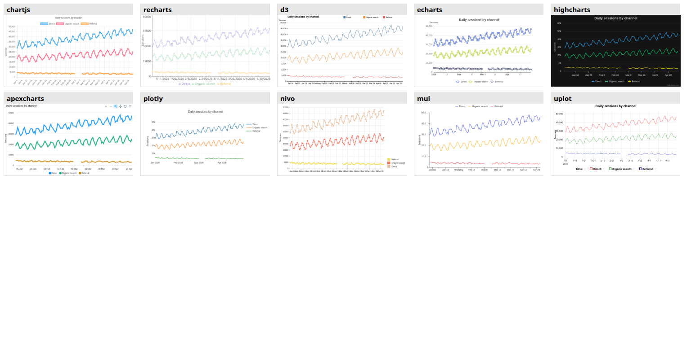
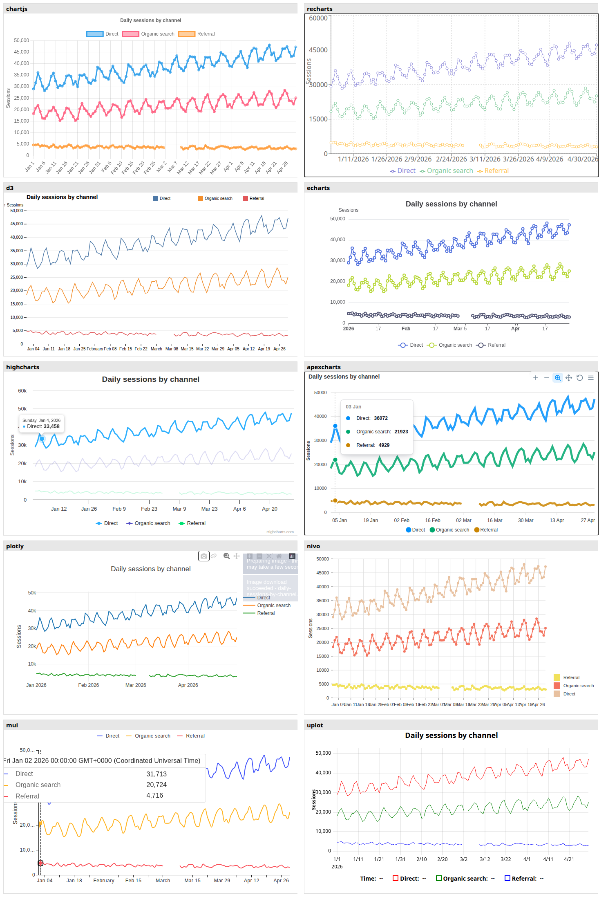
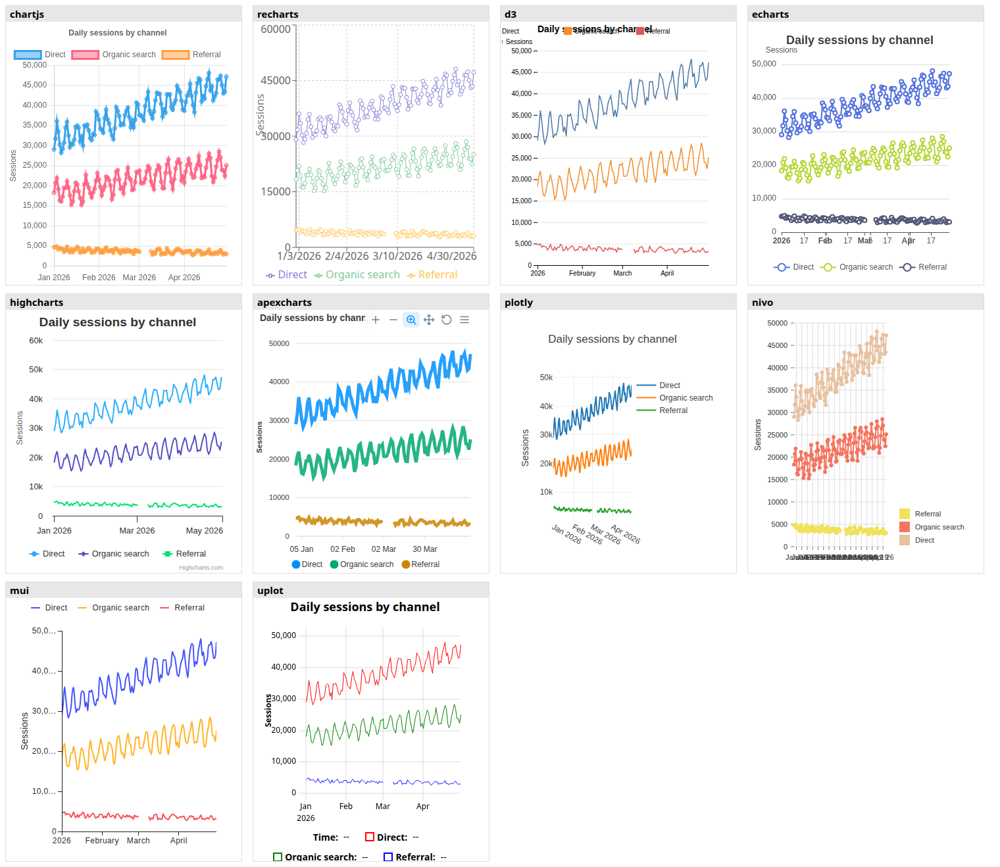

# Phase 1a: the browser charting landscape, November 2026

Revision 2, 2026-11-18. Evidence collected 2026-11-17 and 2026-11-18. Three independent reviews found errors in the first version; the probes they invalidated were rerun and the conclusions below are the corrected ones. What changed and why is in [reviews/2026-11-18/ledger.md](../reviews/2026-11-18/ledger.md). Scripts, raw data and screenshots are in [`research/`](../research/README.md).

## Summary

Ten widely used libraries were given the same reader-facing tasks and two load tasks, each with the least configuration it needs to complete the task. No configuration tested passed all of them. The gaps cluster in three places:

1. **Nobody is told when the data is wrong.** Across five dirty-input fixtures, no library produced a message naming the field, the row or the problem. Nine of ten plotted the string `'40'` as a number without comment. A single `NaN` or `undefined` among valid numbers blanked the whole series in ApexCharts, broke Nivo, and broke either MUI X (`NaN`) or Highcharts (`undefined`, with an exception). Three libraries dropped category labels that did not fit, without saying so.
2. **Accessibility depends on work the author rarely does.** Tested as the other nine were, Highcharts exposes one named image and no keyboard access; with its accessibility module imported it is the most complete of the ten. Three libraries (Recharts, ApexCharts, MUI X) had keyboard navigation on by default in the versions tested. Five exposed nothing a keyboard user could reach. Four keep animating bars under reduced motion. No default palette both reached 3:1 contrast and kept its colors apart under simulated color-vision deficiency.
3. **Fast is something you configure.** Chart.js took 13.7 s of main-thread time to draw a million points with default options and 0.17 s in a tuned configuration. The fastest library by default, uPlot, needs hand-set sizes, colors and time units and has no accessibility layer.

One finding from the first version did not survive review: "six of ten libraries shift dates". Given instants, six show a daily value on a different day in some time zones, which is correct for instants. Given date strings, seven of ten keep the day everywhere. The real gap is narrower: nothing asks the author which one the data is.

Evidence labels used below:

| Label | Meaning |
|---|---|
| **Observed** | Seen in the harness in Chrome 157: rendered, probed or measured. The artifact is in `research/`. |
| **Docs** | Read in the library's current documentation. Not tested unless also marked Observed. |
| **Inferred** | A conclusion drawn from observed facts; the reasoning is stated. |
| **Authored** | The result of code I wrote for the task (all of D3; parts of uPlot's bars and Recharts' colors), not of a library default. |

## 1. Which libraries, and how sure can we be

### 1.1 Adoption data

Three signals, each measuring something different.

| Library | npm package | npm downloads, week of 10–16 Nov 2026 | npm downloads, 12 months | jsDelivr requests, 30 days | Origins detected (mobile crawl, Oct 2026) | GitHub stars |
| --- | --- | --- | --- | --- | --- | --- |
| Recharts | `recharts` | 68.3M | 2,020M | 6.2M | 2,618 | 28k |
| D3 | `d3` | 34.1M | 717M | 64.9M | 15,028 | 114k |
| Chart.js | `chart.js` | 17.0M | 539M | 870.4M | 104,208 | 68k |
| visx | `@visx/shape` | 11.5M | 147M | 45k | no entry | 21k |
| Apache ECharts | `echarts` | 10.7M | 187M | 126.3M | 2,339 | 68k |
| Highcharts | `highcharts` | 3.6M | 116M | 55.4M | 10,988 | 13k |
| ApexCharts | `apexcharts` | 2.8M | 94M | 110.7M | 13,318 | 15k |
| AG Charts | `ag-charts-community` | 2.6M | 69M | 1.1M | no entry | 491 |
| Vega-Lite | `vega-lite` | 2.3M | 35M | 4.5M | no entry | 6k |
| Nivo | `@nivo/core` | 2.0M | 75M | 4k | no entry | 14k |
| Lightweight Charts | `lightweight-charts` | 1.8M | 36M | 3.3M | 353 (TradingView family) | 18k |
| MUI X Charts | `@mui/x-charts` | 1.6M | 45M | 85k | no entry | 6k |
| Observable Plot | `@observablehq/plot` | 1.6M | 22M | 4.6M | no entry | 5k |
| Plotly.js | `plotly.js` + `plotly.js-dist-min`, summed | 1.6M | 52M | 5.0M | 676 | 18k |
| uPlot | `uplot` | 1.0M | 26M | 5.4M | 29 | 11k |
| Victory | `victory` | 763k | 22M | 7k | no entry | 11k |
| amCharts 5 | `@amcharts/amcharts5` | 468k | 15M | 70k | 4,475 (amCharts family, all versions) | 451 |
| C3 | `c3` | 208k | 5.6M | 409k | no entry | 9k |
| Chartist | `chartist` | 138k | 5.2M | 159.0M | no entry | 13k |
| billboard.js | `billboard.js` | 70k | 2.1M | 1.1M | no entry | 6k |
| CanvasJS | `canvasjs` | 4k | 0.2M | 1k | 3,240 | – |
| Google Charts | none | – | – | – | 5,151 | – |

Sources, fetched 2026-11-17: npm downloads API; jsDelivr statistics API; HTTP Archive technology report (crawl of 2026-10-01, 8,466,939 mobile origins in total); GitHub REST API. "No entry" means the HTTP Archive query returned nothing for that name; the collector did not record whether that was a missing fingerprint or a failed lookup.

### 1.2 What these numbers cannot tell us

| Limit | Effect |
|---|---|
| npm counts installs by machines, not people or products. | Every CI run and container build counts. Recharts' latest week is 1.76 times its 12-month weekly average. That shows its package traffic rose; it does not show why, or what share of React teams use it. |
| npm counts transitive installs. | `d3-shape` has 132M downloads a week against D3's 34M, so most of that is other libraries depending on it. AG Charts and Vega-Lite are dependencies of larger products. **Inferred** from package relationships, not measured. |
| npm misses script-tag use. | Chart.js has about 12 times more jsDelivr requests in a month (870M) than npm downloads (roughly 73M). Chartist has 159M CDN requests a month against 138k weekly installs. |
| jsDelivr is one CDN and counts requests. | Libraries served mainly from their own CDN (Highcharts, Google Charts, amCharts, CanvasJS, Plotly) are undercounted. |
| The HTTP Archive crawl loads public home pages. | Dashboards behind a login are not seen. Detection depends on fingerprints, and bundled code often leaves none. Some entries are product families, not single libraries. |
| Wrapper packages overlap their hosts. | `react-chartjs-2` (5.9M a week) is installed alongside `chart.js`, so the two cannot be added. |
| Stars measure past attention. | Chartist and C3 have 13k and 9k stars and almost no current installs. |
| Nothing measures commercial or non-JavaScript use. | Highcharts inside paid products and Plotly through Python and R are not captured. **Inferred**, not quantified. |
| No current survey data was found. | A search for State of JS 2025 charting results returned nothing usable. |

### 1.3 The ten: a chosen sample, not a ranking

The three signals disagree, so there is no single "top ten". What each channel alone would pick ([`research/adoption/ranks.mjs`](../research/adoption/ranks.mjs)):

| Channel | Its top ten |
|---|---|
| npm, 12 months | Recharts, D3, Chart.js, ECharts, visx, Highcharts, ApexCharts, Nivo, AG Charts, Plotly.js |
| jsDelivr | Chart.js, Chartist, ECharts, ApexCharts, D3, Highcharts, Recharts, uPlot, Plotly.js, Observable Plot |
| Detected origins | Chart.js, D3, ApexCharts, Highcharts, Google Charts, amCharts, CanvasJS, Recharts, ECharts, FusionCharts |

| # | Library | Basis for including it |
|---|---|---|
| 1–6 | Chart.js 4.6, Recharts 3.11, D3 7.9, ECharts 6.1, Highcharts 13.1, ApexCharts 8.9 | In every channel's top ten. Chart.js and Highcharts are also named in the brief. |
| 7 | Plotly.js 4.3 | In two channels' top ten. |
| 8 | uPlot 1.6 | Named in the brief; in the jsDelivr top ten. |
| 9 | Nivo 0.99 | In the npm top ten; chosen as a second React library. |
| 10 | MUI X Charts 9.18 | In no channel's top ten. Chosen on judgment: it ships with the most used React component suite and had the most active development of the group. |

So six of the ten are supported by every signal, two by some, and two are judgment calls. D3 has no chart-level API; its tasks are authored code following the official gallery, and every D3 result below is labelled as such.

Left out, with the reason: visx (React primitives, the same role as D3); AG Charts and Vega-Lite (install counts driven by a parent product); Chartist (high CDN traffic, almost no new installs); Google Charts, amCharts, CanvasJS and FusionCharts (strong on detected sites; served from their own CDNs, so the npm-based harness would have needed a different setup, and three are commercial); Observable Plot (the most interesting API of the group); Lightweight Charts (financial); Victory (below the picks on downloads, though it has slightly more stars than uPlot).

A claim such as "no library does X" in this document means no library among these ten, in the configuration tested. AG Charts and Observable Plot in particular were not probed.

### 1.4 Maintenance and cost facts

| Library | Version tested | Published | Stable releases, 12 months | Major versions since Nov 2024 | License | Minified + gzipped, harness module | Harness lines |
| --- | --- | --- | --- | --- | --- | --- | --- |
| Chart.js | 4.6.1 | 2026-10-22 | 1 | none | MIT | 81 KiB | 54 |
| Recharts | 3.11.0 | 2026-11-17 | 12 | v3 (2025-06) | MIT | 140 KiB + React | 83 + 9 shared |
| D3 | 7.9.2 | 2026-11-03 | 2 | none | ISC | 35 KiB | 91 |
| ECharts | 6.1.0 | 2026-05-19 | 1 | v6 (2025-07) | Apache-2.0 | 373 KiB | 63 |
| Highcharts | 13.1.1 | 2026-09-20 | 10 | v12 (2024-11), v13 (2026-06) | Commercial | 143 KiB, accessibility module included | 51 |
| ApexCharts | 8.9.0 | 2026-11-17 | 65 | v5 (2025-07), v6 (2026-07), v7 (2026-08), v8 (2026-10) | Free below a size threshold, otherwise commercial | 289 KiB | 60 |
| Plotly.js | 4.3.0 | 2026-11-10 | 12 | v3 (2025-01), v4 (2026-08) | MIT | 1,450 KiB | 30 |
| Nivo | 0.99.0 | 2025-05-23 | 0 | none | MIT | 129 KiB + React | 54 + 9 shared |
| MUI X Charts | 9.18.1 | 2026-11-16 | 43 | v8 (2025-04), v9 (2026-04) | MIT; zoom and pan need the Pro plan | 160 KiB + React | 44 + 9 shared |
| uPlot | 1.6.32 | 2025-03-14 | 0 | none | MIT | 23 KiB, no donut | 45 |

**Observed** from the npm registry and from bundling each harness module with esbuild. The sizes and line counts are from the first probe pass and are not like for like: each size is the whole harness module (line, bar, donut where it exists, and the load tasks) through the import path the library's getting-started guide shows, with CSS counted as text. Most libraries document a smaller modular import that was not measured. Release counts describe package history; they do not measure how hard an upgrade is. License terms are **Docs** and were read once: the Highcharts shop listed 366 USD per seat for Highcharts Core; ApexCharts' license file sets a $2M threshold and has separate terms for embedding charts in a product, with details on its licensing page that I did not verify; MUI's accessibility page marks zoom and pan as Pro.

## 2. Method

One Vite project loads each library from npm and runs the same tasks into a 720×400 container. A Playwright script drives system Chrome 157 (headless) and records screenshots, the DOM, the accessibility tree, keyboard and pointer behavior, and timings.

**Rule for configuration.** Each task states what the reader must be able to do: see the data with axes and a title, tell series apart, read exact values. Each library gets the least configuration its documentation needs for that, and no styling. This is "minimum to complete the task", not the bare default: ECharts is given its tooltip and legend, and Highcharts its accessibility module, because their documentation presents those as the normal setup. Where a library cannot draw without a choice (a color, a size), the value from its own documentation is used. Section 4.3 reports the accessibility results with each library's switch off and on, since the first version compared one library's opt-in state with nine defaults.

| Task | Data | What it tests |
|---|---|---|
| `trend` | 3 series × 120 daily values as instants (epoch milliseconds at UTC midnight); one series has 7 missing days, so 353 finite values | Time axis, legend, tooltip, number formatting, gaps |
| `dates` | The same series keyed by date strings (`2026-02-24`) | Whether a date stays a date |
| `bars` | 7 categories, values 82–97, one long category name | Zero baseline, label fitting |
| `parts` | 6 shares, two under 3% | Part-to-whole labels, palette |
| `dirty` | `[10, 20, null, NaN, '40', undefined, 70]` | Bad input, combined |
| `dirty-null`, `-nan`, `-string`, `-undefined` | `[10, 20, 30, X, 50, 60, 70]` with one bad value | Bad input, one kind at a time |
| `empty` | The `trend` chart with zero rows | Empty state |
| `scale` | One series of 10,000, 100,000 and 1,000,000 points | Cost to draw |
| `stream` | 600-point window, one new point per animation frame for 300 frames | Cost to update |

Probes on `trend`: Tab, then Right, Right, Down, Enter from the first stop; pointer moved into the plot with the browser in UTC, America/Los_Angeles and Asia/Kolkata; container shrunk from 720 to 360 px; container created at 340 px inside an 800 px viewport; `prefers-color-scheme: dark` on a page that follows it, and on a page that declares itself light-only. On `bars`: first frame against the frame 2.5 s later, with and without `prefers-reduced-motion`.

**What this method cannot show.**

- Chrome only. No Firefox, no Safari, no touch, no real phone viewport.
- No screen reader was run. "Announced" below means text appeared in a live region or an accessible name, not that anything was heard.
- The keyboard walk tries arrows only from the first tab stop, so a library whose point navigation starts elsewhere would be missed.
- The motion probe compares two screenshots of one chart type; "ignores reduced motion" means the bar entry transition specifically. No update was tested.
- Screenshots are cropped to the chart container, so clipping at the container edge and overflow onto the page look the same.
- No task customizes anything: no brand colors, fonts or formatters. The brief asked how developers customize charts; that part of the comparison was not done.
- Every library has options that change most of what follows. The study records what a reader gets when the author does the minimum.

## 3. How the charts look and communicate

### 3.1 Scoreboard

All cells are **Observed** unless marked.

| | Chart.js | Recharts | D3 (authored) | ECharts | Highcharts | ApexCharts | Plotly.js | Nivo | MUI X | uPlot |
|---|---|---|---|---|---|---|---|---|---|---|
| Bars start at zero | yes | yes | yes | yes | yes | yes | yes | yes | yes | no: starts at 80 (bar path builder with the default y range) |
| Long category label | all labels rotated | **label dropped** | overlaps | **5 of 7 dropped** | wrapped | rotated, cut at the container edge | rotated, cut at the container edge | overlaps | **label dropped** | overlaps |
| Time tick labels at 720 px | rotated 45° | crowded | fit | overlap | fit | fit | fit | overlap | fit | fit |
| Thousands on the y axis | `50,000` | `60000` | `50,000` | `50,000` | `60k` | `50000` | `50k` | `50000` | `50,0…` (cut) | `50,000` |
| Marker on every point of a 120-point line | yes | yes | no | yes | no | no | no | yes | no | no |
| Missing days shown as a gap | yes | yes | yes | yes | yes | yes | yes | yes | yes | yes |
| Visible chart title | built in | none | authored | built in | built in | built in | built in | none | none (accessible `title` only) | built in |
| Donut: slice values readable without hovering | 0 of 6 | 6 of 6 (absent 1.8 s after creation, present at 4 s) | 4 of 6 (authored) | 0 of 6 (names only) | 0 of 6 (names only) | 4 of 6 (percent) | 6 of 6 (percent) | 6 of 6, two overlap | 0 of 6 | no donut |
| Empty data | invented axes (0–1.0, hours) | blank frame | blank frame | blank | blank | invented axis (0–6) | invented axes (−1 to 6) | "Jan 01" eight times | **"No data to display"** | blank |

### 3.2 Findings

**R1. Zero baseline.** Nine of ten start bars at zero. uPlot has no bar chart type; with its bar path builder and the default y range, bars started at 80. That is a configuration a uPlot author would be expected to complete, and a place where a default can mislead.

**R2. Labels that do not fit are the most common visible failure.** Only Highcharts wrapped "Customer Success & Onboarding". Recharts and MUI X removed that label and left a bar with no name; ECharts kept two labels of seven. Nivo, uPlot and the authored D3 chart overlapped text. ApexCharts and Plotly rotated the labels and they were cut at the container edge. Chart.js rotated all labels, and they stayed complete and readable.

**R3. Instants and dates are not told apart.** The pointer was moved to the same place with the browser in three zones. The cell shows the date each library displayed.

Given instants (epoch milliseconds at UTC midnight):

| Library | Reader in UTC | Los Angeles | Kolkata | Same day everywhere |
| --- | --- | --- | --- | --- |
| Chart.js | Feb 24, 12:00 a.m. | Feb 23, 4:00 p.m. | Feb 24, 5:30 a.m. | no |
| ECharts | 2026-02-26 00:00 | 2026-02-25 16:00 | 2026-02-26 05:30 | no |
| Plotly.js | Mar 10 | Mar 9 | Mar 10 | no |
| Nivo | Sat Mar 07 00:00 | Fri Mar 06 16:00 | Sat Mar 07 05:30 | no |
| MUI X Charts | Mon Feb 23 00:00 | Sun Feb 22 16:00 | Mon Feb 23 05:30 | no |
| uPlot | 02-24 12:00am | 02-23 4:00pm | 02-24 5:30am | no |
| Highcharts | Feb 24 | Feb 24 | Feb 24 | yes (UTC by default) |
| ApexCharts | 24 Feb | 24 Feb | 24 Feb | yes (UTC by default) |
| Recharts | decided by the author's formatter; the harness formatter showed the local date | | | – |
| D3 (authored) | UTC scale chosen in the code | | | – |

Given date strings:

| Same day in all three zones | Day still depends on the zone |
|---|---|
| Chart.js, ECharts, Highcharts, ApexCharts, Plotly.js; Recharts (prints the string on a category axis); D3 (authored) | Nivo (its default tooltip prints a `Date` in local time); MUI X and uPlot (they accept only `Date` objects or numbers, so the string has to be converted first) |

Showing 4:00 p.m. on the previous day is a faithful rendering of an instant. It is wrong only if the author meant a calendar date, and common back ends deliver calendar dates as UTC-midnight instants (a `Date` serialized to JSON, for example). **Inferred**: the gap is not that libraries shift dates, but that none of the ten asks or signals which kind of value it was given.

The Chart.js tooltip is drawn on canvas; its text was read through the library's tooltip API for one known datum and is saved in `results.json` under `chartjs.dates`.

**R4. Default value formatting is uneven.** Recharts, ApexCharts and Nivo print `50000` on the axis. Nivo's default tooltip is `x: Sat Mar 07 2026 00:00:00 GMT+0000 (Coordinated Universal Time), y: 24930`, and MUI X's tooltip heading is the same raw date string. Plotly abbreviates the tooltip value to `36.832k`, which is exact here but not how a reader would write 36,832. ECharts' generated accessibility description (section 4.3) reads out timestamps as `1767225600000`.

**R5. Bad input is not reported.** Outcomes with one bad value among six valid ones:

| | `null` | `NaN` | `'40'` (a string) | `undefined` |
|---|---|---|---|---|
| Chart.js | gap | gap | plotted as 40 | gap |
| Recharts | gap | gap | plotted as 40 | gap |
| ECharts | gap | gap | plotted as 40 | gap |
| Plotly.js | gap | gap | plotted as 40 | gap |
| Highcharts | gap | gap | gap | **throws** `Cannot read properties of undefined (reading 'x')`; empty chart |
| ApexCharts | gap | **whole series missing**, no message | plotted as 40 | **whole series missing**, no message |
| Nivo | gap | **chart broken**, 14 console errors | plotted as 40 | **chart broken**, 14 console errors |
| MUI X Charts | gap | **chart broken**, 21 console errors | plotted as 40 | gap |
| uPlot | gap | **line drawn across** | plotted as 40 | line drawn across (documented: `undefined` means "join") |
| D3 (authored, `.defined()` omitted on purpose) | line stops | line stops | plotted as 40 | line stops |

Every library handled `null` as a gap. Nine plotted a numeric string as a number, and Highcharts silently left it out; none said so either way. The only messages were one exception from minified code and browser SVG attribute errors. No library named the field, the row or the problem. Whether plotting `'40'` is wrong depends on the data (database drivers return large counts as strings); the finding is that the author is not told that a guess was made.

**R6. Empty results look broken.** Only MUI X says "No data to display". Chart.js, ApexCharts, Plotly and Nivo draw axes with invented ranges; the rest are blank. Highcharts' generated description for the empty chart reads "Data ranges from 1970-01-01 00:00:00 to 1970-01-01 00:00:00".

**R7. Default palettes fail contrast, color-vision checks, or both.** The colors of the six donut slices, in order, scored for contrast against white (WCAG 1.4.11 asks 3:1 for graphical objects that are needed to understand the content) and for the smallest pairwise difference in OKLab under normal vision and Machado-simulated deficiencies. Repeated colors count as a pair with zero difference.

| Library | Colors of the six slices | Distinct | Below 3:1 on white | Closest pair: normal | Protanopia | Deuteranopia | Tritanopia |
| --- | --- | --- | --- | --- | --- | --- | --- |
| Chart.js | `#36a2eb` `#ff6384` `#ff9f40` `#ffcd56` `#4bc0c0` `#9966ff` | 6 | 5 | 0.108 | 0.114 | 0.084 | 0.051 |
| Recharts (documentation colors; it has no palette) | `#0088fe` `#00c49f` `#ffbb28` `#ff8042` `#0088fe` `#00c49f` | 4 | 4 | 0 | 0 | 0 | 0 |
| ECharts | `#5070dd` `#b6d634` `#505372` `#ff994d` `#0ca8df` `#ffd10a` | 6 | 4 | 0.100 | 0.016 | 0.047 | 0.092 |
| Highcharts | `#2caffe` `#544fc5` `#00e272` `#fe6a35` `#6b8abc` `#d568fb` | 6 | 4 | 0.123 | 0.107 | 0.012 | 0.082 |
| ApexCharts | `#008ffb` `#00a86f` `#ca8501` `#ff4560` `#846dd5` `#008ffb` | 5 | 0 | 0 | 0 | 0 | 0 |
| Plotly.js | `#1f77b4` `#ff7f0e` `#2ca02c` `#d62728` `#9467bd` `#8c564b` | 6 | 1 | 0.142 | 0.007 | 0.039 | 0.068 |
| Nivo | `#e8c1a0` `#f47560` `#f1e15b` `#e8a838` `#61cdbb` `#97e3d5` | 6 | 6 | 0.087 | 0.040 | 0.069 | 0.065 |
| MUI X Charts | `#4254fb` `#ffb422` `#fa4f58` `#0dbeff` `#22bf75` `#fa83b4` | 6 | 4 | 0.131 | 0.081 | 0.046 | 0.067 |

ApexCharts is the only one whose colors all reach 3:1, and its sixth slice has the same blue as its first, next to it on the ring. Recharts has no palette (every line is `#3182bd` and every sector `#808080` until the author assigns colors); the repeat above comes from cycling the four colors its examples use, which is **authored**. uPlot has no palette. Plotly's orange and green are nearly identical under simulated protanopia (0.007). ECharts was scored from its option palette, not from rendered pixels.

A search under the same metric found eight-color sets that reach 3:1 and keep a minimum difference of 0.12 on white and 0.14 on a dark background ([`research/palette/feasibility.json`](../research/palette/feasibility.json)). Those sets cover few hues, differ between light and dark, and were scored as swatches, not as 2 px lines. So the thresholds are reachable; whether a palette people would choose meets them is open.

**R8. Dense lines get a marker on every point in four libraries.** Chart.js, Recharts, ECharts and Nivo draw one for each of the 353 values; at 340 px the lines turn into beads.

**R9. Titles and units are thin in the React libraries.** Recharts and Nivo have no chart title. MUI X has a `title` prop that sets an accessible label only. In Recharts and MUI X the y-axis title overlapped the tick labels with the documented placement. Highcharts titles an untitled y axis "Values".

**R10. Following the page's color scheme is rare, and following the device is not the same thing.** On a page that follows `prefers-color-scheme: dark`, two charts stayed legible without configuration: Highcharts 13, which switches palette and text, and the authored D3 chart, whose axis text uses the inherited color. On a page that declares itself light-only, viewed on a device set to dark, Highcharts drew a black chart on the white page: it follows the device preference, not the page. The other nine stayed light there. **Inferred**: a chart should take its scheme from the page it is in.

## 4. How readers explore and interact

### 4.1 Scoreboard

All cells are **Observed** in Chrome's accessibility tree and by scripted keyboard and pointer input. No screen reader was run.

| | Chart.js | Recharts | D3 (authored) | ECharts | Highcharts + module | ApexCharts | Plotly.js | Nivo | MUI X | uPlot |
|---|---|---|---|---|---|---|---|---|---|---|
| What the accessibility tree holds | nothing | legend list; an `application` element with no label, containing the tick text | image containing all the chart's text | nothing | named region, heading, generated description, a region per series | named `application`, legend buttons | two unnamed images, a toolbar | unnamed image | legend list, status region; the `title` label sits on a `role="none"` element | title text, legend table |
| Tab stops in the chart | 0 | 8, of which 7 land on unlabeled groups | 0 | 0 | 2 | 10 | 9: eight toolbar buttons and a link | 0 | 1 | 0 |
| Arrow keys move between points | no | yes | no | no | yes | yes | no | no | yes | no |
| Focused point's text reaches a live region | no | yes, `assertive` | no | no | no: tooltip only, the polite region stayed empty | yes, polite | no | no | no: tooltip only | no |
| Focused point shown visually | – | not in the screenshot | – | – | yes | yes | – | – | yes | – |
| Tooltip with the pointer between points | none | all series | all series (authored) | all series | one series | all series | one point | one point | all series | all series, in the legend |
| Follows a container resize without code | yes | yes | scales like an image | **no** | yes | yes | **no** | yes | yes | **no** |
| Bars animate on first render | yes | yes | no | yes | yes | yes | no | yes | yes | no |
| …and stop under reduced motion | **no** | yes | – | **no** | **no** | yes | – | **no** | yes | – |

### 4.2 Findings

**R11. Half of the ten give a keyboard or assistive-technology user nothing to work with by default.** Chart.js and ECharts put one unlabeled canvas on the page. uPlot adds a title and a legend table that reads `--` until a mouse moves. Nivo is an unnamed image; the authored D3 chart is an image whose only content is its tick text. Chart.js' documentation leaves making the canvas accessible to the author (**Docs**, page dated 2021).

**R12. Four configurations have keyboard navigation, with rough edges.** It was on by default in Recharts, ApexCharts and MUI X (the ApexCharts and MUI X documentation confirm the default), and in Highcharts once its module is imported. Observed rough edges:

- Recharts and ApexCharts use `role="application"`, which changes how screen readers pass keys through. Recharts' element has no label of its own. Leaving the Recharts chart took eight Tab presses.
- ApexCharts has ten tab stops on this chart, six of them toolbar buttons for a zoomable time axis. **Inferred**: a dashboard of such charts multiplies that.
- Highcharts and MUI X moved a visual focus marker and tooltip, but in this probe the point's text never reached a live region or the focused element's name. Whether a screen reader conveys it another way was not tested.
- MUI X's documentation says the feature is still being developed (**Docs**).
- Plotly's tab stops are its toolbar; the data cannot be reached.

**R13. One configuration describes the chart.** Highcharts with its module generated: "Line chart with 3 lines. The chart has 1 X axis displaying Time. Data ranges from 2026-01-01 00:00:00 to 2026-04-30 00:00:00. The chart has 1 Y axis displaying Sessions. Data ranges from 2732 to 48085." No tested configuration offers a data table without a further module.

**R14. The bar entry animation ignores reduced motion in four of the seven that animate.** Chart.js, ECharts, Highcharts and Nivo produced the same early-frame difference with `prefers-reduced-motion: reduce` as without. None of their packages contains that media query string ([`spot-checks.json`](../research/harness/spot-checks.json)). Recharts, ApexCharts and MUI X stop.

**R15. Tooltips differ in basic behavior.** With the pointer in the plot between points, Chart.js shows nothing; its default requires the pointer to intersect a point. Highcharts, Plotly and Nivo describe one series or point; the others list all series at that x. MUI X's tooltip extended past the container's right edge.

**R16. Three libraries do not follow their container.** ECharts, Plotly and uPlot stayed 720 px wide when the container shrank to 360 px. Each documents a resize call or option. uPlot needs pixel sizes up front.

### 4.3 Accessibility with each library's switch off and on

The first version compared Highcharts with its module against nine libraries without an equivalent. Both states, where a single documented switch exists:

| Library | Switch | Off | On |
|---|---|---|---|
| Highcharts | Import `modules/accessibility` | One image named by the title; 0 tab stops; a console message recommends the module | Named region, generated description, keyboard navigation, 2 tab stops |
| ECharts | `aria: { enabled: true }` (no extra import with the full build) | One unlabeled canvas | `role="img"` with a generated label that lists the first ten items of each series, timestamps as raw numbers; still 0 tab stops |
| MUI X Charts | `title` prop | Legend list and status region; no named chart | The label is set on an element with `role="none"`, so no named chart appeared in the tree |
| Recharts, ApexCharts | On by default | – | As in 4.1 |
| Chart.js, Plotly.js, Nivo, uPlot, D3 | None found | As in 4.1 | – |

So "Highcharts is the strongest" holds only with its module, which is one import. By default it is in the weaker half.

## 5. How developers create, update and maintain

Customization was not compared (section 2).

### 5.1 What each library needed beyond data

**Observed** while writing the harness ([`research/harness/src/libs/`](../research/harness/src/libs)). These are what one author needed, not proof that no shorter way exists.

| Library | Had to know or add |
|---|---|
| Chart.js | A date adapter package before a time axis works. `maintainAspectRatio: false` to fill a fixed-height container. |
| Recharts | Reshape the data into row objects. A color for every series. A tick formatter for a numeric time axis. Eight components for one line chart. |
| D3 | Everything: title, legend, readout and axes are authored, with no keyboard access. |
| ECharts | `tooltip` and `legend` are absent unless declared. |
| Highcharts | The accessibility module is a separate import. |
| ApexCharts | A numeric height: `height: '100%'` produced a 456 px chart in a 400 px container. |
| Plotly.js | Nothing extra. The shortest module, and 1,450 KiB gzipped with the documented import. |
| Nivo | Margins by hand, or axes are clipped. `useMesh` for a tooltip. A five-property object for a legend. A canvas line component exists and was not tested. |
| MUI X Charts | `@mui/material` and `@mui/system` as peer dependencies. It also accepts row objects through a `dataset` prop, which the harness did not use. |
| uPlot | Pixel width and height, a stroke color per series, x in seconds (or an option to accept milliseconds), a path builder plus a custom axis for bars. |

### 5.2 Findings

**D1. Line counts are similar; hidden knowledge is not.** What separates the libraries is the list above: things that give a broken or blank chart with no message when missed.

**D2. Five data shapes for the same table.** Parallel arrays with labels (Chart.js, uPlot), `[x, y]` pairs per series (ECharts, Highcharts, ApexCharts), row objects keyed by series (Recharts), `{ id, data: [{ x, y }] }` (Nivo), and separate x and y arrays (Plotly, MUI X). The harness fixture is columnar and had to be reshaped a different way for each.

**D3. Seven update idioms.** Mutate then `chart.update()` (Chart.js); `setOption` (ECharts); `series.addPoint` (Highcharts); `updateSeries` (ApexCharts); `Plotly.extendTraces`; `setData` (uPlot); re-render with new props (the React three).

**D4. Bundle cost spans a wide range** with the documented imports: 23 KiB to 1,450 KiB gzipped for the harness modules (section 1.4, with its caveats).

**D5. Errors do not help.** The one exception in the study came from minified code and named neither the option nor the data.

**D6. Release cadence ranges from none to very frequent.** Nivo and uPlot have had no release in 18 and 20 months. ApexCharts shipped four major versions in 16 months. Whether either is a problem for a user depends on what broke, which this study did not test.

**D7. Licensing splits the field.** Highcharts is paid for commercial use; ApexCharts is free only below a size threshold; MUI X charges for zoom and pan. The fully permissive libraries include the ones with the weakest accessibility defaults, plus Recharts and MUI X's free tier.

### 5.3 Load

Two metrics from headless Chrome 157 on one desktop machine, median of three runs.

- **Main-thread task time to draw**: time the browser reports its main thread busy, from the create call until 1.6 s after the second animation frame, long enough for entry animations to finish. It counts work however the library schedules it. The first row is the same measurement with no chart.
- **Main-thread task time per update** while streaming: the same counter over 300 updates, divided by 300.

| Library and configuration | 10,000 points | 100,000 points | 1,000,000 points | Streaming: main-thread time per update | Frame callbacks later than 20 ms (of 300) |
| --- | --- | --- | --- | --- | --- |
| No chart (measurement floor) | 8 ms | 8 ms | 9 ms | 0.1 ms | 0 |
| Chart.js, defaults | 1.2 s | 2.3 s | 13.7 s | 10.7 ms | 2 |
| Recharts, defaults | 2.5 s | 9.4 s | no result in 45 s | 15.2 ms | 17 |
| D3 (authored: one SVG path, x axis redrawn) | 27 ms | 87 ms | 521 ms | 1.1 ms | 0 |
| ECharts, defaults | 1.4 s | 2.8 s | 12.9 s | 15.7 ms | 30 |
| Highcharts, defaults | 114 ms | 399 ms | 2.7 s | 3.5 ms | 0 |
| ApexCharts, defaults | 83 ms | 134 ms | 636 ms | 9.7 ms | 3 |
| Plotly.js, defaults | 51 ms | 119 ms | 365 ms | 6.1 ms | 0 |
| Nivo, defaults | 733 ms | 5.0 s | no result in 45 s | 27.1 ms | 247 |
| MUI X Charts, defaults | 99 ms | 366 ms | 3.0 s | 4.0 ms | 0 |
| uPlot, defaults | 41 ms | 52 ms | 97 ms | 1.0 ms | 0 |
| Chart.js, tuned configuration | 75 ms | 73 ms | 165 ms | 2.0 ms | 0 |
| ECharts, tuned configuration | 65 ms | 119 ms | 512 ms | 2.2 ms | 0 |
| Recharts, tuned configuration | 104 ms | 563 ms | 5.9 s | 4.7 ms | 0 |
| Highcharts, Boost module (WebGL, software-rendered here) | 103 ms | 153 ms | 513 ms | 2.8 ms | 0 |
| Plotly.js, `scattergl` (WebGL, software-rendered here) | 215 ms | 935 ms | 8.2 s | 17.3 ms | 23 |

How far these numbers can be trusted:

- Three runs on one machine. Read them for order of magnitude.
- Main-thread time does not include rasterization done on other threads, which matters for large SVG paths.
- The streaming producer waits for an animation frame before each update, so a slow library receives a slower feed, and "later than 20 ms" counts late callbacks, not dropped frames.
- The first version reported only the synchronous part of each update call. By that measure uPlot took under 0.1 ms; its redraw is deferred, and the real cost is about 1 ms.
- The first version's D3 rows were invalid: the authored chart pinned its y axis at zero while the test data went negative, so most of the line was outside the plot. The rows above are from the corrected chart. Its y axis still does not follow the stream.
- The tuned configurations are whole configurations. Chart.js' changes input format, parsing, decimation, animation, markers and stroke width; Recharts' removes the legend and grid. They show what a different configuration costs, not what any one option does.
- The two WebGL rows ran on SwiftShader, a software rasterizer (`spot-checks.json`). They say nothing about WebGL on a GPU.
- No adapter except D3's was checked for showing the right domain and window after the fact.

**D8. Whole configurations differ by one to two orders of magnitude.** Chart.js: 13.7 s by default against 0.17 s tuned at a million points. ECharts: 12.9 s against 0.5 s. The cause is not isolated to one option.

**D9. Plain JavaScript on Canvas 2D sets a high bar.** uPlot drew a million points in about 0.1 s of main-thread time and updated a 600-point window in about 1 ms. Any claim that another technology is needed has to beat numbers of that order.

**D10. One DOM node per point is slow; SVG as such is not.** Recharts and Nivo, which create an element per point by default, took 5 to 9 seconds at 100,000 points. The authored D3 chart and Plotly's default trace, which draw one SVG path per series, took about 0.1 s. Nivo's canvas component was not tested.

## 6. What the findings add up to

| Opening | Evidence | Closest among the ten |
|---|---|---|
| Tell the developer, and the reader, when the data could not be drawn as given | R5, R6, D5 | None |
| Fit every label, or say what is hidden | R2 | Highcharts (wraps); Chart.js (rotates legibly) |
| Ask whether a time value is a date or an instant, and show the zone | R3 | Highcharts and ApexCharts avoid the surprise by defaulting to UTC |
| Accessible without an import, an option or a plan | R11–R14, R7, R10, 4.3 | Highcharts with its module (commercial), then ApexCharts and Recharts by default |
| Take the color scheme from the page | R10 | None (Highcharts follows the device) |
| Fast with default options | D8–D10 | uPlot; Plotly and ApexCharts are within an order of magnitude |
| One data model, one update contract, small bundle, permissive license | D2–D4, D7 | Chart.js on license; uPlot on size |

Among these ten, in the configurations tested, none is strong in more than two rows. The product specification in [02-product-spec.md](02-product-spec.md) is built on holding all of them for a small set of chart types. Two libraries outside the ten, AG Charts and Observable Plot, may be stronger on accessibility defaults and on UTC handling respectively, and should be probed before Axylo claims a gap exists across the whole field.
