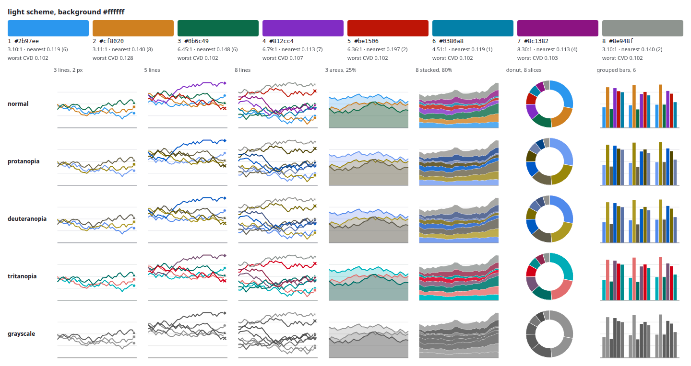
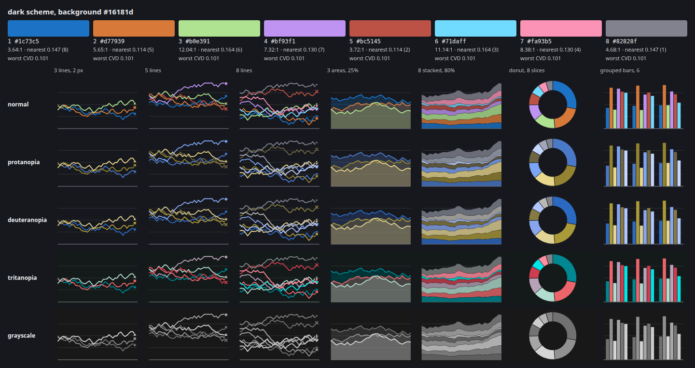

# Decision 0003: the default categorical palette

Status: **proposed, refitted after review.** The first version (commit 51e1be5) was reviewed by Codex gpt-6.2-astra (`reviews/2026-11-18/impl/wp/palette.review.md`). The review confirmed the arithmetic and showed four things wrong: the uneven lightness was claimed to be forced and is not; simulated screenshots and 8-bit fills fell below the limits the record promised; the order explorer could prune a feasible order after a timeout; and the record overclaimed in several places. This version is a refit with byte-level checks and corrected text. The hard constraints are measured and tested. Whether the result is good to look at is the owner's call (see "For the owner"). The refit (52bbdf0) was reviewed again (`reviews/2026-11-18/impl/wp/misc-opus.review.md`, part B; reported to me as Codex gpt-6.2-sol). This version answers that review. It also adds **candidate B**, a second palette awaiting the owner's choice, which nobody else has reviewed.

Spec: A5 (palette thresholds, provisional), L2 (3:1 for marks), F9 (eight series). Finding R7, docs/01-landscape.md.

## The palette

Slot order: blue, orange, green, purple, red, cyan, magenta, slate. That is the first version's order. Hue families are kept per slot.

| Slot | Family | Light | OKLCH | Contrast on #ffffff | Dark | OKLCH | Contrast on #16181d | Hue shift |
|---|---|---|---|---|---|---|---|---|
| 1 | blue | `#4a94eb` | 0.66 0.150 254 | 3.12 | `#64acfa` | 0.73 0.135 252 | 7.46 | 2° |
| 2 | orange | `#e97200` | 0.68 0.175 52 | 3.06 | `#de7b2e` | 0.68 0.150 54 | 5.90 | 2° |
| 3 | green | `#136102` | 0.43 0.140 141 | 7.67 | `#b2e390` | 0.86 0.121 133 | 12.08 | 8° |
| 4 | purple | `#7314a2` | 0.43 0.205 310 | 8.93 | `#9149b9` | 0.54 0.177 312 | 3.26 | 2° |
| 5 | red | `#bd585e` | 0.59 0.130 18 | 4.45 | `#c3513d` | 0.58 0.151 32 | 3.86 | 14° |
| 6 | cyan | `#007baa` | 0.55 0.115 234 | 4.76 | `#71d8ff` | 0.83 0.110 225 | 10.97 | 9° |
| 7 | magenta | `#a52265` | 0.49 0.175 355 | 6.96 | `#f898b5` | 0.79 0.119 1 | 8.58 | 6° |
| 8 | slate | `#9293a5` | 0.67 0.026 283 | 3.03 | `#7a7f93` | 0.60 0.031 274 | 4.47 | 9° |

**One token changes.** The dark focus token goes from `#79a8ff` to a near-white `#e3e8f0`, which is 14.4:1 on #16181d. The old focus blue sat at OKLab L 0.735, exactly where a dark-mode series blue belongs. With it kept, no dark set I found had a first blue above L 0.55. The exact search with the blue asked for at 0.62 ended at `#3970c2`, L 0.55 (`configs/dark-n2.json`, best within 300 s). The light focus `#1f5fcc` is unchanged; `keyboard.browser.test.ts` hardcodes it. Every other token is unchanged.

**Before and after.**

| | 51e1be5 | Now |
|---|---|---|
| Light OKLab L, lowest to highest | 0.39 to 0.68 | 0.43 to 0.68 |
| Light, spread across the first three | 0.26 | 0.25 |
| Light, largest chroma | 0.17 | 0.205 (purple) |
| Dark first blue | `#1c73c5`, L 0.55, 3.64:1 | `#64acfa`, L 0.73, 7.46:1 |
| Dark, largest chroma | 0.15 | 0.177 (purple) |
| Largest light/dark hue shift | 18.5° (slate), 8° chromatic | 13.6° (red) |
| Byte-rounded simulation, worst pair | 0.098 (light protan 6–8) | 0.102 |
| 25% fills on an 8-bit raster, worst neighbours | 0.0590 (review's raster) | 0.063 (Chrome, canvas and SVG) |

The dark blue now has ordinary dark-mode lightness. The light set did not get much more even. Slot 3's green is still the heaviest of the first three lines on white (L 0.43 against 0.66 and 0.68). "Tried and failed" below says what I searched for that and why I stopped.





Each preview shows:
- the swatches, with hex, contrast and nearest neighbour;
- lines with 3, 5 and 8 series at 2 px, with Axylo's end markers;
- three overlapping areas at 25%;
- eight stacked areas at 80%;
- an eight-slice donut;
- grouped bars.

The same charts are repeated under the three simulations (the Machado matrices as SVG color matrices in linear RGB) and in grayscale. Source: `research/palette/preview.html`.

## What is measured, and on what

There are three forms of measurement:

- **Analytic.** The 8-bit hex is decoded, then simulated or composited in floating point, then converted to OKLab.
- **Bytes.** Values are rounded where an 8-bit image would round them. A simulated color is encoded and rounded to the nearest byte before the OKLab conversion. This is a rounding model, not the preview image: Chrome's SVG filter in the preview differs from it by one byte in one channel (light tritanopia, slot 7: `#b30f41` in the PNG, `#b20f41` in the model), which takes the light tritan 5–7 distance from 0.102 in the model to 0.1005 in the image. A translucent fill is quantised as a raster would quantise it: alpha at round(α×255), each channel rounded. That reproduces Chrome 157's canvas and SVG fills on white exactly and is within one byte on #16181d. The second variant, alpha at floor(α×255), is what the review's CPU Skia raster did.
- **Chrome.** The fill pixels Chrome actually drew, canvas and SVG (`research/palette/raster.mjs`), and the preview PNG itself: `preview.mjs` reads back the middle of every donut slice in every row of the image it just wrote (`preview-pixels.json`).

The unit test requires the analytic and the byte forms. It checks the recorded Chrome fill pixels against the 0.06 limit and the recorded preview pixels against 0.10, and checks that each recorded pixel is within one byte of its model. A stricter margin is the worst case over every byte color within one byte per channel of both fills. It is recorded but not required, because I found no palette that meets it together with the rest (0.054–0.056 is the best I saw; see below).

## Constraints, measured

These come from `research/palette/palette.json`, which `score.mjs` writes. The unit test recomputes each value with its own code and compares it at the written precision, including which pair is closest; the fields it checks are listed in `research/palette/README.md`. Limits are applied to unrounded values; the record keeps three decimals.

| Constraint | Check | Limit | Light | Dark |
|---|---|---|---|---|
| 1 | lowest contrast on background | ≥ 3 | 3.03 (slate) | 3.26 (purple) |
| 2 | min pairwise ΔE, all 8, normal / protan / deutan / tritan | ≥ 0.10 | 0.124 / 0.103 / 0.103 / 0.102 | 0.116 / 0.104 / 0.103 / 0.102 |
| 2, bytes | the same after the simulation is rounded to bytes | ≥ 0.10 | 0.124 / 0.103 / 0.103 / 0.102 | 0.116 / 0.103 / 0.102 / 0.102 |
| 2, image | the same on the donut slices read back from the preview PNG | ≥ 0.10 | 0.124 / 0.103 / 0.103 / 0.1005 | 0.116 / 0.103 / 0.102 / 0.102 |
| 3 | first 4, worst vision (analytic; bytes) | ≥ 0.14 | 0.156 protan; 0.155 | 0.158 tritan; 0.159 |
| 3 | first 3, 5, 6, worst vision (analytic) | ≥ 0.10 | 0.156 / 0.102 / 0.102 | 0.158 / 0.103 / 0.103 |
| 4 | largest light/dark OKLCH hue shift | ≤ 30° | 13.6° (red) | same pairs |
| 5 | nearest series color to focus / reference / muted | ≥ 0.10 | 0.101 (cyan) / 0.152 (green) / 0.110 (cyan) | 0.138 (cyan) / 0.104 (cyan) / 0.113 (slate) |
| 6 | neighbour fills at 25%: ideal / byte models / Chrome canvas / Chrome SVG | ≥ 0.06 | 0.064 / 0.063 / 0.063 / 0.063 | 0.064 / 0.064 / 0.063 / 0.063 |
| 6 | neighbour fills at 80%: ideal / byte models / Chrome | ≥ 0.06 | 0.201 / 0.202 / 0.202 | 0.179 / 0.179 / 0.179 |
| 6, recorded only | 25% fills, worst case within one byte | (0.06) | 0.056 | 0.056 |

"Muted" is my addition to constraint 5: the donut draws its "Other" slice in the muted token, next to series slices.

### Prefix minima (constraint 3)

Each cell is analytic / bytes, with the closest slots.

| Prefix | Vision | Light | Dark |
|---|---|---|---|
| first 3 | normal | 0.319 / 0.319 (1–2) | 0.251 / 0.251 (2–3) |
| first 3 | protan | 0.156 / 0.155 (2–3) | 0.247 / 0.246 (1–3) |
| first 3 | deutan | 0.270 / 0.271 (2–3) | 0.178 / 0.177 (2–3) |
| first 3 | tritan | 0.243 / 0.241 (1–3) | 0.158 / 0.159 (1–3) |
| first 4 | normal | 0.284 / 0.284 | 0.246 / 0.246 |
| first 4 | protan | 0.156 / 0.155 | 0.247 / 0.246 |
| first 4 | deutan | 0.217 / 0.217 | 0.178 / 0.177 |
| first 4 | tritan | 0.157 / 0.157 | 0.158 / 0.159 |
| first 5 | normal / protan / deutan / tritan | 0.135 / 0.103 / 0.136 / 0.102 | 0.116 / 0.126 / 0.109 / 0.103 |
| first 6 | normal / protan / deutan / tritan | 0.124 / 0.103 / 0.117 / 0.102 | 0.116 / 0.124 / 0.109 / 0.103 |

The full tables with pair identities for every row are printed by `node research/palette/score.mjs --md`.

### Tight pairs and margins

These are every measured value within 5% of its limit (`palette.json`, `tight`):

- **Light:**
  - contrast 3.026 (slate; the solver keeps 3.02);
  - all-eight pairwise 0.102–0.103 under the three deficiencies, analytic and in bytes;
  - first five and six 0.102–0.103;
  - focus distance 0.101 (cyan against `#1f5fcc`).
- **Dark:**
  - all-eight pairwise 0.102–0.104;
  - first five and six 0.102–0.103;
  - reference distance 0.104 (cyan against `#bcc0c9`).
- **Fills, both schemes:** the 25% neighbours have about 0.003–0.004 of room; the 80% fills have a lot.

How fragile is that to a hand edit? I tried every one-byte change of one channel of one color: 41 of 46 light edits and 46 of 47 dark edits still meet every required check (`palette.json`, `oneByteEdits`). The first version of this record said that "almost any hand edit fails". That was wrong; the review measured 36/48 and 32/47 for 51e1be5. A changed hex still fails the record test until `score.mjs` is rerun.

The solver kept margins above the tested limits: pairwise 0.102, fills 0.063, contrast 3.02, hue shift 15° for chromatic slots (`configs/fit-final.json`, `solverLimits`). In the final boxes it proved 0.065/0.103 and 0.066/0.102 infeasible, so the margins cannot be much larger near this palette.

## Focus token under a two-tone ring

The second review (`reviews/2026-11-18/impl/wp/misc-opus.review.md`, part B, finding 1) showed that a single-ink focus indicator cannot work with this dark set. `#e3e8f0` is under 3:1 against five dark series colors: blue 1.93, orange 2.45, green 1.19, cyan 1.32 and pink 1.68 (purple 4.42, red 3.74 and slate 3.23 pass). No single ink reaches 3:1 against both `#16181d` and the light green. The same holds in light: `#1f5fcc` is between 1.18 and 1.95:1 against every light series color. A datum outline crossing a mark therefore fails WCAG 1.4.11 wherever it is drawn in one ink. The chart core is changing the indicator to two tones: a ring in the focus token, with a surround in the background color between the ring and the marks. That is not in my files.

**What the token must satisfy under the two-tone ring:**

1. **The focus color must reach 3:1 against the background.** The ring is seen against its surround, which is the background color. Light `#1f5fcc` on `#ffffff` is 5.89:1; dark `#e3e8f0` on `#16181d` is 14.43:1. Both pass; the L2 token test asserts it.
2. **The surround must reach 3:1 against every mark it touches.** That is constraint 1 read the other way: every series color reaches 3:1 on its background (lowest 3.03 light, 3.26 dark), and the axis and reference tokens do too. Nothing new is needed.
3. **The focus color needs no contrast against series colors.** The surround keeps them from touching.

**Constraint 5 is no longer needed for contrast.** That is, the 0.10 OKLab distance between every series color and the focus token. It never could provide contrast in any case: an OKLab distance is not a contrast ratio. What it buys is identity: the ring's color never coincides with a series color, so a focused datum's outline is not read as a mark of its own or another series. That matters most for slot 1, the most-used series. The old dark focus `#79a8ff` is 0.024 from today's dark blue `#64acfa`, so a ring around a series-1 point would be drawn in nearly that series' own color. I recommend keeping constraint 5. Dropping it would allow `#79a8ff` to return (7.49:1 on the background, so it would pass under two tones) at the cost of that confusion. This is the owner's call.

**Candidate B changes no token.** It is checked against the same focus, reference and muted tokens (below), and its lowest contrasts (3.10 light, 3.07 dark) carry the surround the same way.

## Candidate B (awaiting the owner's choice)

**Not shipped.** `palette.ts` still holds the palette above. The owner chooses between the two. Candidate B changes series colors only. Backgrounds and tokens stay as shipped.

```text
light  #2b97ee #cf8020 #0b6c49 #812cc4 #be1506 #0380a8 #8c1382 #8e948f
dark   #5d9afd #dc772f #ade4ba #9443a9 #ba4f1f #38c7fe #d991b8 #6d736e
```

**How it was made.** I started from the second review's pair (part B, "More even light scheme"). That pair meets every limit, and I confirmed it with the same code. Judged by eye, it has two faults:
- Its sixth slot is a second blue. Light `#4f81b7` is 2° of hue from `#1e97fa`; dark `#387bf0` is 9° from `#64acfa`.
- Its dark red `#fe573f` (chroma 0.207 at L 0.68) is the loudest mark in the dark scheme.

So I did three things:
- moved slot 6 to cyan and teal hues (`configs/b-cyan.json`, `b-cyan-45.json`);
- held both eighths at chroma 0.015 or less;
- held the dark red and orange at chroma 0.15 or less.

The light set came from annealing, then an exact local search (`configs/b-polish-light.json`). The dark set came from an exact search against it (`b-polish-dark.json`). `configs/candidate-b.json` puts small boxes around both with the solver margins. Both searches complete and reproduce `candidates/candidate-b.json`. The README lists the commands.

| Slot | Family | Light | OKLCH | Contrast | Dark | OKLCH | Contrast | Hue shift |
|---|---|---|---|---|---|---|---|---|
| 1 | blue | `#2b97ee` | 0.66 0.160 248 | 3.10 | `#5d9afd` | 0.69 0.160 260 | 6.35 | 12° |
| 2 | orange | `#cf8020` | 0.67 0.140 65 | 3.11 | `#dc772f` | 0.67 0.150 52 | 5.69 | 13° |
| 3 | green | `#0b6c49` | 0.47 0.100 162 | 6.45 | `#ade4ba` | 0.87 0.081 152 | 12.33 | 10° |
| 4 | purple | `#812cc4` | 0.50 0.220 305 | 6.79 | `#9443a9` | 0.53 0.171 319 | 3.07 | 14° |
| 5 | red | `#be1506` | 0.51 0.200 30 | 6.36 | `#ba4f1f` | 0.56 0.150 42 | 3.57 | 12° |
| 6 | cyan | `#0380a8` | 0.56 0.110 229 | 4.51 | `#38c7fe` | 0.78 0.140 229 | 9.11 | 0° |
| 7 | magenta | `#8c1382` | 0.45 0.190 332 | 8.30 | `#d991b8` | 0.74 0.100 346 | 7.35 | 14° |
| 8 | slate | `#8e948f` | 0.66 0.010 151 | 3.10 | `#6d736e` | 0.55 0.011 151 | 3.66 | 0° |

**Measured.** This is the record `research/palette/palette-b.json`, which `score.mjs --palette=` writes from candidate B's own Chrome records: `raster-b.json`, `preview-b-pixels.json` and `strokes-b.json`. Nothing was refused. The unit test's candidate-B block checks every limit again with its own code: analytic and in bytes, Chrome's fill pixels, and the PNG's donut pixels.

| Constraint | Check | Limit | Light | Dark |
|---|---|---|---|---|
| 1 | lowest contrast | ≥ 3 | 3.10 (slate) | 3.07 (purple) |
| 2 | all 8, normal / protan / deutan / tritan, analytic | ≥ 0.10 | 0.113 / 0.102 / 0.102 / 0.102 | 0.115 / 0.105 / 0.102 / 0.103 |
| 2, bytes | the same, simulation rounded to bytes | ≥ 0.10 | 0.113 / 0.103 / 0.102 / 0.102 | 0.115 / 0.105 / 0.102 / 0.103 |
| 2, image | the same on the donut slices of `preview-b-*.png` | ≥ 0.10 | 0.113 / 0.103 / 0.102 / 0.102 | 0.115 / 0.105 / 0.102 / 0.103 |
| 3 | first 4, worst vision, analytic; bytes | ≥ 0.14 | 0.144 tritan; 0.143 | 0.162 deutan; 0.164 |
| 3 | first 3 / 5 / 6, worst vision, analytic | ≥ 0.10 | 0.149 / 0.102 / 0.102 | 0.188 / 0.113 / 0.105 |
| 4 | largest hue shift | ≤ 30° | 14.1° (purple) | same pairs |
| 5 | nearest to focus / reference / muted | ≥ 0.10 | 0.116 (cyan) / 0.121 (green) / 0.111 (cyan) | 0.104 (green) / 0.107 (green) / 0.102 (pink) |
| 6 | 25% fills: ideal / byte models / Chrome canvas / Chrome SVG | ≥ 0.06 | 0.065 / 0.064 / 0.064 / 0.064 | 0.064 / 0.064 / 0.063 / 0.063 |
| 6 | 80% fills: ideal / byte models / Chrome | ≥ 0.06 | 0.223 / 0.224 / 0.224 | 0.175 / 0.174 / 0.175 |
| 6, recorded only | 25% fills, worst case within one byte | (0.06) | 0.060 | 0.057 |

Other records:
- **One-byte edits:** 44 of 48 light and 48 of 48 dark still meet every check.
- **Strokes:** the lowest weighted p10 at DPR 1, over both renderers, is 2.42 light and 2.43 dark. The shipped figures are 2.38 and 2.55.

**Against the shipped palette and the review's pair:**

| | Shipped | Review's pair | Candidate B |
|---|---|---|---|
| Light L, lowest to highest | 0.43–0.68 | 0.46–0.67 | 0.45–0.67 |
| Light L spread, first three | 0.25 | 0.19 | 0.20 |
| Light largest chroma | 0.205 (purple) | 0.207 (purple, red) | 0.220 (purple) |
| Hue gap, slot 1 to slot 6, light / dark | 20° / 27° | 2° / 9° | 19° / 30° |
| Eighth's chroma, light / dark | 0.026 / 0.031 (hue 283 / 274) | 0.012 / 0.011 | 0.010 / 0.011 |
| Dark largest chroma | 0.177 (purple) | 0.207 (red) | 0.171 (purple) |
| Dark first blue | `#64acfa`, L 0.73 | `#64acfa` | `#5d9afd`, L 0.69 |
| Lowest contrast, light / dark | 3.03 / 3.26 | 3.03 / 3.09 | 3.10 / 3.07 |

**What it costs:**
- **Light purple at chroma 0.220,** above both other sets. In candidate B's neighbourhood, a cap of 0.207 is proved infeasible: the exact search in `configs/b-purple-207.json` completes with no solution. Calming the light red pushes purple up instead. Red at 0.18 or 0.17 is feasible only with purple at 0.23 (`b-red-18.json`, `b-red-17.json`), and red at 0.16 is proved infeasible (`b-red-16.json`).
- **A loud light red.** `#be1506` is a full red, like the review's `#c61405`.
- **Light floor at 0.45, not the review's 0.46.** With every light color at 0.46 or above, my searches found only a steel-blue sixth (`b-walk3.json`, hue 242) or nothing (`b-cyan.json`, `b-indigo.json`). That is a search result, not a proof.
- **A deeper dark blue.** Keeping `#64acfa` against this light set was not found (`b-dark-blue.json`): the exact search timed out and annealing found nothing.
- **Dimmer dark purple and tighter dark tokens.** The dark purple is 3.07:1 (shipped 3.26). The dark token margins are tighter: focus 0.104 and muted 0.102.
- **A more saturated dark cyan.** `#38c7fe` has chroma 0.14 against the shipped 0.11. I asked for 0.115; the exact search went to 0.14.

**Recommendation: adopt candidate B.** The owner decides. The reasons can be checked in `research/palette/compare-light.png` and `compare-dark.png`. Each shows the same seven panels, shipped above and candidate B below, in normal vision; the simulated rows are in `preview-b-*.png`.
- **Calmer first three (light, "3 lines").** In the shipped set the deep green line is clearly the heaviest and the orange the hottest. In B the ochre and the lighter green sit closer to the blue.
- **A neutral eighth (both images, swatch 8).** The shipped slate reads as a lavender grey. B's reads as grey in both schemes.
- **Slot 6 distinct from slot 1 (swatches 1 and 6, the donut).** Both sets show sky blue against teal in light, and blue against cyan in dark. The review's pair did not, and B keeps that distinction.
- **No colour shouting in dark ("8 lines", the donut).** B's pink is dusty rather than candy-bright, and its red is a brick like the shipped one, not the review's `#fe573f`. Its cyan is the most saturated dark color, but it does not dominate either panel.

**Against adopting it:** in light "8 lines", B's red is the loudest line, which the shipped coral is not. B's light purple is the most chromatic color in either set. If the owner finds that red too loud, the shipped palette remains the better default. Nobody other than me has reviewed candidate B.

To adopt it, copy its arrays into `palette.ts` and rerun the first block in the README. The first block of the unit test then covers it, and the candidate-B block becomes redundant.

## Thin lines

`strokes.mjs` draws each color as a 2 px random-walk polyline in headless Chrome 157 (canvas and SVG, device pixel ratio 1 and 2) and reads the pixels back. For each pixel column it records two values:

- **Core:** the most covered pixel.
- **Weighted:** the coverage-weighted mean of the touched pixels, bg + (Σc²/Σc)(ink − bg), with coverage at or below 0.02 dropped.

This is a legibility measurement of this rendering path, not the WCAG test. WCAG 1.4.11 allows the specified stroke color to be assessed despite antialiasing, and A5 is met on the swatch.

Weighted p10 / median contrast, by renderer and device pixel ratio (`strokes.json`):

| Scheme, slot | Color | Swatch | Canvas DPR 1 | SVG DPR 1 | Canvas DPR 2 | SVG DPR 2 |
|---|---|---|---|---|---|---|
| light 1 | `#4a94eb` | 3.12 | 2.47 / 2.57 | 2.47 / 2.57 | 2.75 / 2.84 | 2.75 / 2.84 |
| light 2 | `#e97200` | 3.06 | 2.50 / 2.59 | 2.48 / 2.59 | 2.75 / 2.81 | 2.75 / 2.81 |
| light 3 | `#136102` | 7.67 | 4.89 / 5.27 | 4.88 / 5.27 | 6.03 / 6.32 | 6.03 / 6.32 |
| light 4 | `#7314a2` | 8.93 | 5.97 / 6.40 | 5.96 / 6.40 | 7.32 / 7.64 | 7.29 / 7.64 |
| light 5 | `#bd585e` | 4.45 | 3.27 / 3.44 | 3.27 / 3.44 | 3.75 / 3.91 | 3.75 / 3.91 |
| light 6 | `#007baa` | 4.76 | 3.46 / 3.64 | 3.46 / 3.64 | 4.03 / 4.18 | 4.03 / 4.14 |
| light 7 | `#a52265` | 6.96 | 4.86 / 5.17 | 4.83 / 5.17 | 5.80 / 6.03 | 5.80 / 6.03 |
| light 8 | `#9293a5` | 3.03 | 2.38 / 2.47 | 2.38 / 2.47 | 2.65 / 2.71 | 2.65 / 2.71 |
| dark 1 | `#64acfa` | 7.46 | 5.32 / 5.66 | 5.32 / 5.61 | 6.26 / 6.49 | 6.26 / 6.49 |
| dark 2 | `#de7b2e` | 5.90 | 4.27 / 4.51 | 4.27 / 4.51 | 5.00 / 5.17 | 5.00 / 5.17 |
| dark 3 | `#b2e390` | 12.08 | 8.32 / 8.85 | 8.23 / 8.85 | 9.97 / 10.39 | 9.97 / 10.39 |
| dark 4 | `#9149b9` | 3.26 | 2.57 / 2.65 | 2.55 / 2.65 | 2.87 / 2.95 | 2.87 / 2.95 |
| dark 5 | `#c3513d` | 3.86 | 2.93 / 3.09 | 2.93 / 3.09 | 3.35 / 3.43 | 3.35 / 3.43 |
| dark 6 | `#71d8ff` | 10.97 | 7.59 / 8.10 | 7.52 / 8.10 | 9.08 / 9.46 | 9.08 / 9.46 |
| dark 7 | `#f898b5` | 8.58 | 6.04 / 6.42 | 6.04 / 6.42 | 7.14 / 7.45 | 7.14 / 7.45 |
| dark 8 | `#7a7f93` | 4.47 | 3.36 / 3.55 | 3.36 / 3.55 | 3.88 / 3.99 | 3.88 / 3.99 |

The core p10 equals the swatch to two decimals in every row and renderer. Counted from the raw pixel record (`strokes-raw.json.gz`), every color has a fully covered pixel in 575 of 576 columns at DPR 1 (one column without, both renderers) and in all 1,152 at DPR 2. Canvas and SVG differ by up to 0.09 (dark green, DPR 1 p10: 8.32 canvas, 8.23 SVG), most often by 0.00–0.03. The unit test recomputes every statistic in this table, and both column counts, from the raw record. Every series also has a full-color marker at its last point and at sparse intervals (spec A5).

## Why lightness spreads on white (corrected)

The first version said that each simulation "removes one chromatic axis", and that three deep colors were therefore forced. Both statements were wrong.

The Machado matrices act in linear RGB, not in OKLab. In OKLab they mostly compress the red–green direction (protanopia, deuteranopia) or the blue–yellow direction (tritanopia), but they also move lightness. For example, the first version's light blue has L 0.659 unsimulated and between 0.643 and 0.691 across the simulations. The compression is a design heuristic, not a proof.

The review then exhibited a two-scheme palette meeting all six constraints with light L from 0.48 to 0.69:

```text
light  #3791ff #d28204 #2b6d48 #881bbd #c70f09 #1f7fae #fe1ce0 #959396
dark   #63d2fc #f9c309 #78aa6f #bf37be #e42129 #4574fa #ee5ec3 #7e7c80
```

It lay outside the boxes my what-if runs had searched. That pair pays in chroma: its magenta has chroma 0.30, its red 0.21 and its purple 0.23, and a hue shift sits at 29.97°. The second review then found a pair with light L 0.460–0.673 and chroma at most 0.207 (part B, "More even light scheme"). So the uneven lightness of the shipped set is not the price of restrained chroma either. Candidate B (above) starts from that pair.

## How the refit was done

1. **Wider boxes, exact search.** `fit.mjs` with light floors at L 0.44–0.48 and chroma up to 0.18–0.22 (`configs/even-a.json`, `even-c.json`). Both now require analytic and byte-rounded pairwise distances and both byte models for fills. No palette was found within 300 s. That is a timeout, not a proof.
2. **Annealing.** `anneal.mjs` searches the same grids by minimising the total shortfall. I checked it first on a known-feasible neighbourhood: it recovered the review's palette. From random starts it found feasible light sets only once the boxes were split into tiers: blue, orange and slate near 3:1, red and cyan in the middle, green, purple and magenta lower (`configs/tier-44-free.json`). It found nothing with every color at L 0.46 or above (`configs/tier-46-cr.json`).
3. **Dark against that light set.** The searches with the old focus token failed: `dark-a2.json` (annealing) and `dark-n2.json` (exact; best blue L 0.55). Moving the dark focus to near-white let annealing find a set with a light dark-mode blue and a deeper purple (`configs/dark-c.json`).
4. **Polish.** `configs/fit-final.json` puts small boxes around both results and adds the solver margins. Both exact searches complete, so the run is deterministic and reproduces the shipped arrays: `node research/palette/fit.mjs --config=research/palette/configs/fit-final.json --seconds=300`.
5. **Explorer fixed.** `explore.mjs orders` now keeps three outcomes per order (feasible, proved infeasible, timed out). It prunes only on a completed proof and prints all three. The first version's family and order statistics came from the faulty explorer, and I did not rerun them in full, so they are withdrawn.

## Tried and failed

Each line below means "not found". Only searches that complete prove anything, and those are marked.

- **A lighter, calmer slot-3 green** (L 0.46 or above, chroma 0.11 or below), with restrained chroma elsewhere (`configs/green-a.json`; `green-b.json`, which also allowed a saturated red): nothing. The shortfalls were green against red under protanopia, and magenta against cyan and slate. The review's palette does have such a green (`#2b6d48`). It pays for it with a near-3:1 magenta at chroma 0.30, which the walk below could not bring down.
- **Walking from the review's palette toward lower chroma** while staying feasible (`configs/walk-b.json`): the green and red calmed down, but the magenta stayed at chroma 0.28 or more (`#fd26e0`).
- **The review's tier structure with chroma held at 0.22 or less** (`configs/cx-a.json`): nothing; magenta was always the shortfall.
- **Red third**, as in Tableau 10 (`configs/red3-a.json`): nothing; red was short against green under protanopia.
- **Magenta fourth instead of purple**, to relieve the dark blue (`configs/mag4-a.json`): feasible on white. Its dark set was proved infeasible with the old focus token (exact search, `configs/dark-n2-m4.json`), and annealing found none with the new one (`configs/dark-b2-m4.json`).
- **Fills at the worst case within one byte per channel**: never met together with the other goals. The shipped palette's worst case is 0.056 in both schemes, short by 0.004.
- **A palette with every light color at L 0.48 or above that also keeps chroma at 0.22 or less**: none found. My conclusion at the time, that the lightness-for-chroma trade was real, was wrong: the second review found an L 0.46 floor at chroma 0.207 by searching a wider range of hues. My searches were limited in time, boxes and hue ranges.

## Additions beyond the six constraints

- **Muted token** in constraint 5 (tested). The donut's "Other" slice.
- **Byte-level checks** (tested): byte-rounded simulation; fills on both 8-bit raster models; Chrome's drawn pixels within one byte of the model and 0.06 apart.
- **Ring closure and deficiency-simulated fills** (recorded only). At 25% the donut's closing pairs go down to 0.032 (light 8–1) and 0.037 (dark 6–1). Neighbours under simulation go down to 0.024 (light, deuteranopia). Slices are opaque in Axylo, so constraint 2 covers them.
- **Solver margins** as listed above; the tests use the decision's limits.

## For the owner

- **Shipped palette or candidate B?** See "Candidate B (awaiting the owner's choice)" and `research/palette/compare-light.png`, `compare-dark.png`. I recommend B. The case against it is its louder light red and purple.
- **Is the light set's weight acceptable?** Three colors (green, purple, magenta at L 0.43–0.49) are much darker than the three at 3:1. In the 3-series chart the green line is clearly the heaviest. I could not remove that at restrained chroma. The review's palette is more even and noticeably louder; its magenta reads as hot pink.
- **The dark focus ring becomes near-white `#e3e8f0`** (light stays blue). This is a visible UI change, made to free the dark blue. With the two-tone ring it meets its contrast need (14.4:1 on the background). Reverting to `#79a8ff` is possible under two tones only if constraint 5 is dropped (see "Focus token under a two-tone ring").
- **The dark set mixes very light green, cyan and pink** (L 0.79–0.86) with a deep purple (0.54) and a mid red (0.58). Purple and red are the dimmest (3.26 and 3.86:1).
- **Slot hues moved within each family.** The light red is a coral (hue 18), the dark red a brick (hue 32). That 13.6° shift is the largest.

## Reference palettes (measured)

These are read from the installed d3-scale-chromatic 3.1.1 (`research/harness/node_modules`) by `research/palette/references.mjs` and scored with the same code (`research/palette/references.json`). Minima are over the first eight colors.

| Scheme | Below 3:1 on white | Min ΔE normal / protan / deutan / tritan (closest slots) |
|---|---|---|
| schemeTableau10 | 5 of 10 | 0.129 / 0.016 / 0.007 (3–5, red–green) / 0.064 |
| schemeObservable10 | 6 of 10 | 0.113 / 0.059 / 0.020 / 0.046 |
| schemeCategory10 (D3's default, Plotly's) | 4 of 10 | 0.113 / 0.007 (2–3) / 0.039 / 0.042 |
| schemeDark2 | 2 of 8 | 0.099 / 0.018 / 0.017 / 0.049 |
| schemeSet1 | 5 of 9 | 0.130 / 0.031 / 0.035 / 0.066 |

Library defaults as rendered are in R7 (docs/01-landscape.md). That table has eight displayed six-slice rows. Recharts' row uses its documentation's authored colors, the D3 chart is authored, uPlot has no default palette, and ECharts was read from its options. What I took from these: the blue-then-orange opening (Tableau 10, Category 10), a quiet neutral last, and the evidence that the familiar sets put adjacent hues that deuteranopia merges (Tableau 10's red and green at 0.007). The first version also drew on palettes recalled from memory (IBM Carbon, Okabe–Ito, Paul Tol). No arrays for them are installed here, so they are not cited.

## Not verified

- The browser suites that sample palette colors were not run, because they need `npm run build`.
  - `render.browser.test.ts` and `theme.browser.test.ts` read the colors from `palette.ts`, so they should follow; that is inferred.
  - `keyboard.browser.test.ts` checks the light focus only, and that token is unchanged.
  - Any browser test that checks the dark focus ring's color would see `#e3e8f0` now.
  - The two-tone focus ring is being built in the chart core; its rendered contrast against marks has not been measured here.
- Raster checks cover isolated fills over the background. A 25% area over another 25% area (overlapping areas) is not scored.
- The simulation is Machado at severity 1.0 only.
- Strokes and fills were measured in headless Chrome 157 on Linux only.
- Nobody with a color-vision deficiency has looked at the previews.
- Candidate B has not been reviewed by anyone else. It has not been through the browser suites either, which read `palette.ts`.

## Files

- `packages/axylo/src/theme/palette.ts`: both series sets and the dark focus token. Exported names and shapes are unchanged.
- `packages/axylo/test/theme/palette.test.ts`: constraints 1–6, analytic and in bytes; Chrome fill pixels; the record at written precision; stroke-record validation; the preview PNG's pixels; candidate B's checks, Chrome fills and preview PNG.
- `research/palette/`: `color.mjs`, `fit.mjs`, `anneal.mjs`, `explore.mjs`, `score.mjs`, `raster.mjs`, `strokes.mjs`, `preview.mjs`, `references.mjs`, `configs/`, `palette.json`, `raster.json`, `strokes.json`, `strokes-raw.json.gz`, `preview-pixels.json`, `references.json`, `preview.html` and the two PNGs.
- Candidate B: `research/palette/configs/candidate-b.json` and `b-*.json`, `candidates/candidate-b.json`, `palette-b.json`, `raster-b.json`, `strokes-b.json`, `strokes-b-raw.json.gz`, `preview-b.html`, `preview-b-light.png`, `preview-b-dark.png`, `preview-b-pixels.json`, `compare.html`, `compare-light.png`, `compare-dark.png`. See the README there.
